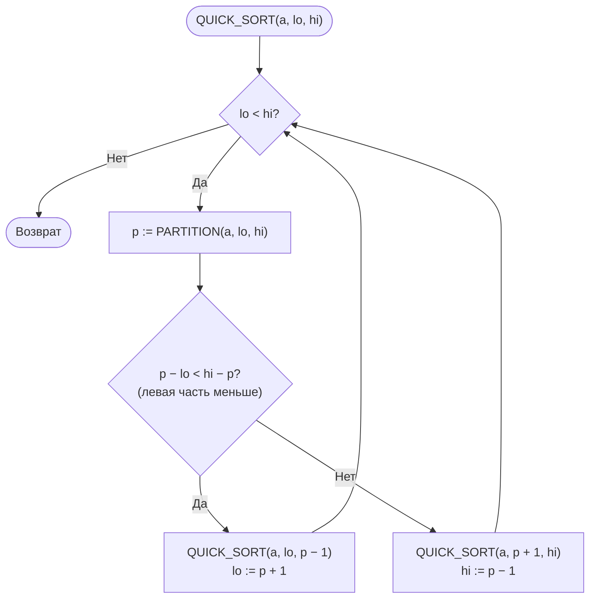
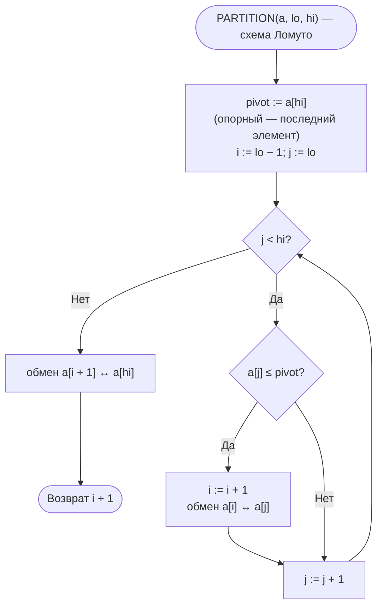
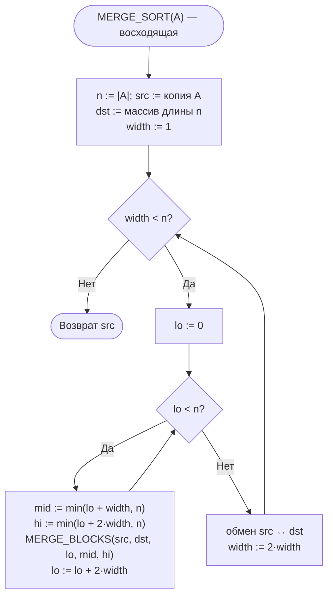
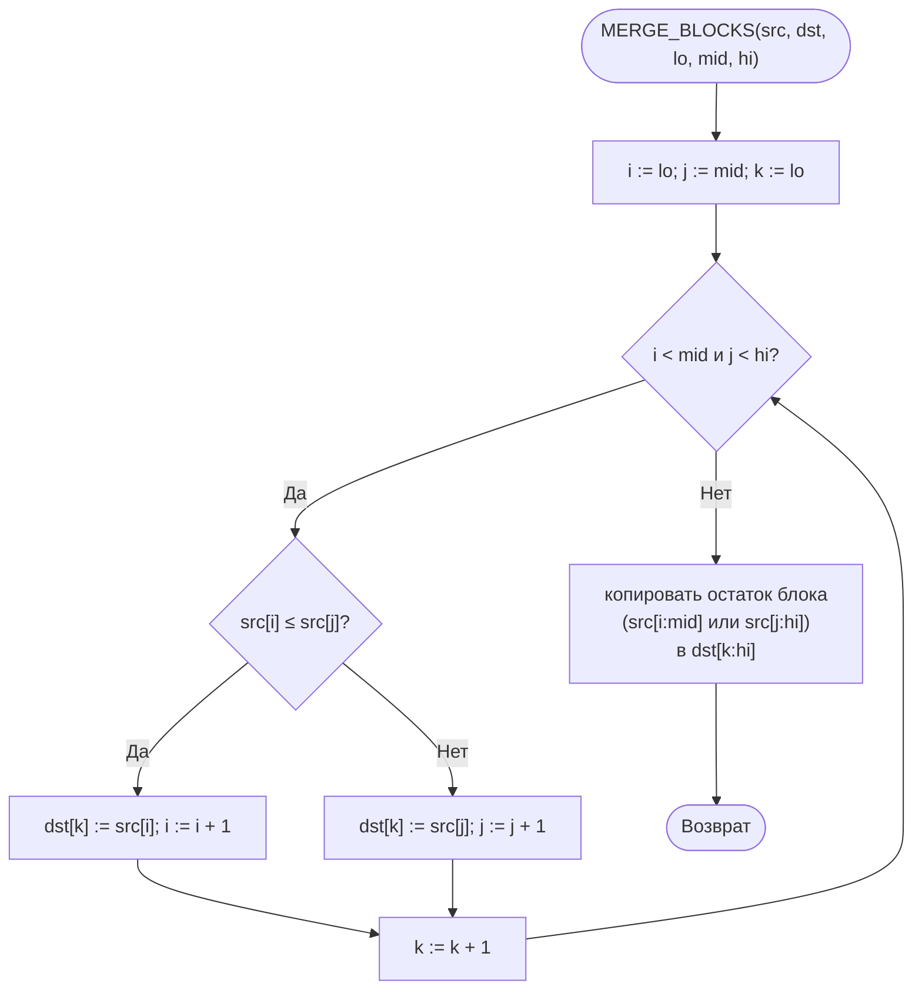

# Лабораторная работа № 3. Вариант 19

**Эмпирический анализ временной сложности алгоритмов сортировки. Часть 2: алгоритмы на основе парадигмы «разделяй и властвуй» (быстрая сортировка и сортировка слиянием)**

| | |
|---|---|
| **Дисциплина** | Теория алгоритмов |
| **Направление** | 38.03.05 «Бизнес-информатика» |
| **Выполнила** | Ситникова Ольга |
| **Группа** | БИ 2-1 |
| **Вариант** | 19 |
| **Язык** | Python 3.10+ (`time`, `random`, `statistics`, `matplotlib`) |

## Файлы работы

| Файл | Назначение |
|---|---|
| [`otchet_lr3_variant19.pdf`](otchet_lr3_variant19.pdf) | Отчёт (титульный лист, теория, блок-схемы, листинг, система, таблицы и графики экспериментов 1–3, сводная таблица, выводы) |
| [`README.md`](README.md) | Описание работы (этот файл) |
| [`lr3_variant19.py`](lr3_variant19.py) | Программа: алгоритмы, эксперименты 1–3, задание Г1, графики |

## Запуск

```bash
pip install matplotlib
python lr3_variant19.py          # графики сохраняются в lr3_plot.png и lr3_plot_g1.png
python lr3_variant19.py --show   # дополнительно открыть окно с графиками
```

Файл самодостаточен: функции ЛР № 2 (`bubble_sort`, `insertion_sort`) включены в него, отдельные модули не нужны. Полный прогон занимает около полутора минут (на данных D схема Ломуто работает несколько секунд — это ожидаемая квадратичная деградация).

## 1. Задание варианта 19

| Опорный | Разбиение | Слияние | Размеры n для эксперимента 2 | Доп. задание |
|---|---|---|---|---|
| К — последний | Л — Ломуто | В — восходящее (итеративное) | 10 000; 25 000; 40 000; 55 000; 70 000 | Г1 |

- **Эксперимент 1** — пузырьком, вставками, быстрая, слиянием на размерах варианта 19 ЛР № 2 (n = 1000…6000): на случайных данных и на почти упорядоченных (тип N из варианта ЛР № 2).
- **Эксперимент 2** — быстрая, слиянием, гибридная быстрая и `sorted()` на больших n (плюс серия с удвоением n для проверки T(2n)/T(n)).
- **Эксперимент 3** — быстрая и слиянием на данных разной структуры. Так как опорный элемент — **последний**, на упорядоченных данных быстрая сортировка работает за Θ(n²), поэтому типы S и V исследуются при n ≤ 3000–4000, типы R, N, D — при n = 50 000, все пять типов — при n = 3000.
- **Г1** — гибридная быстрая сортировка: подмассивы длиной ≤ M сортируются вставками; M выбирается из {5, 10, 16, 32, 64}.

## 2. Теоретические оценки

| Алгоритм | Лучший | Средний | Худший | Доп. память | Устойчивость |
|---|---|---|---|---|---|
| Пузырьком | Θ(n) | Θ(n²) | Θ(n²) | O(1) | Да |
| Вставками | Θ(n) | Θ(n²) | Θ(n²) | O(1) | Да |
| Слиянием | Θ(n log n) | Θ(n log n) | Θ(n log n) | Θ(n) | Да |
| Быстрая | Θ(n log n) | Θ(n log n) | Θ(n²) | O(log n) | Нет |

- Слияние (восходящее): ⌈log₂ n⌉ проходов по Θ(n) операций → Θ(n log n) во всех случаях.
- Быстрая: T(n) = 2T(n/2) + Θ(n) в среднем; в худшем T(n) = T(n−1) + Θ(n) = Θ(n²). Для опорного «последний» худший случай — упорядоченные и обратно упорядоченные данные. Рекурсия идёт в меньшую часть, глубина стека O(log n).
- Ожидаемое T(2n)/T(n) ≈ 2 + δ (≈ 2,13 при n ≈ 10⁴–10⁵), для квадратичных — 4.

## 3. Блок-схемы

### Быстрая сортировка



### Разбиение Ломуто (опорный — последний элемент)



### Сортировка слиянием (восходящая)



### Слияние двух соседних блоков



## 4. Условия эксперимента

Процессор: Intel(R) Xeon(R) Processor @ 2.30GHz (2 логических ядра), ОЗУ 8 ГБ, Linux (Ubuntu 24.04), Python 3.13.18, таймер `time.perf_counter()`, k = 5 повторов, результат — медиана, значения данных из [0; 50 000]. Абсолютные значения на другом компьютере будут отличаться, соотношения должны сохраниться.

## 5. Результаты

**Таблица 1. Эксперимент 1а — случайные данные, с**

| n | Пузырьком | Вставками | Быстрая | Слиянием |
|---:|---:|---:|---:|---:|
| 1 000 | 0,0242 | 0,0114 | 0,0006 | 0,0007 |
| 2 000 | 0,1039 | 0,0483 | 0,0012 | 0,0016 |
| 3 000 | 0,2342 | 0,1079 | 0,0018 | 0,0026 |
| 4 000 | 0,4169 | 0,1896 | 0,0031 | 0,0035 |
| 5 000 | 0,6449 | 0,2988 | 0,0036 | 0,0047 |
| 6 000 | 0,9503 | 0,4375 | 0,0045 | 0,0059 |

**Таблица 2. Эксперимент 1б — почти упорядоченные данные (тип N варианта 19 ЛР № 2), с**

| n | Пузырьком | Вставками | Быстрая | Слиянием |
|---:|---:|---:|---:|---:|
| 1 000 | 0,0151 | 0,0016 | 0,0027 | 0,0006 |
| 2 000 | 0,0637 | 0,0089 | 0,0027 | 0,0015 |
| 3 000 | 0,1495 | 0,0132 | 0,0043 | 0,0023 |
| 4 000 | 0,2456 | 0,0226 | 0,0067 | 0,0031 |
| 5 000 | 0,4087 | 0,0381 | 0,0109 | 0,0044 |
| 6 000 | 0,5883 | 0,0524 | 0,0080 | 0,0054 |

**Таблица 3. Эксперимент 2 — большие массивы (случайные данные), с**

| n | Быстрая | Слиянием | Гибрид (M = 16) | `sorted()` | Слиянием / быстрая |
|---:|---:|---:|---:|---:|---:|
| 10 000 | 0,0086 | 0,0107 | 0,0082 | 0,0010 | 1,25 |
| 25 000 | 0,0227 | 0,0304 | 0,0214 | 0,0028 | 1,34 |
| 40 000 | 0,0399 | 0,0499 | 0,0369 | 0,0048 | 1,25 |
| 55 000 | 0,0519 | 0,0704 | 0,0485 | 0,0070 | 1,36 |
| 70 000 | 0,0703 | 0,0959 | 0,0648 | 0,0091 | 1,36 |

**Таблица 4. Рост T(n₂)/T(n₁) для соседних размеров эксперимента 2**

| Переход | Быстрая | Слиянием | Теория O(n log n) | Теория O(n²) |
|---:|---:|---:|---:|---:|
| 10 000 → 25 000 | 2,64 | 2,84 | ≈ 2,75 | 6,25 |
| 25 000 → 40 000 | 1,76 | 1,64 | ≈ 1,67 | 2,56 |
| 40 000 → 55 000 | 1,30 | 1,41 | ≈ 1,42 | 1,89 |
| 55 000 → 70 000 | 1,35 | 1,36 | ≈ 1,30 | 1,62 |

**Таблица 5. Эксперимент 2б — удвоение n (случайные данные)**

| Переход | Быстрая | Слиянием | Теория O(n log n) |
|---:|---:|---:|---:|
| 12 500 → 25 000 | 2,09 | 2,14 | ≈ 2,15 |
| 25 000 → 50 000 | 2,33 | 2,18 | ≈ 2,14 |
| 50 000 → 100 000 | 2,00 | 2,18 | ≈ 2,13 |

**Таблица 6. Эксперимент 3а — типы R, N, D при n = 50 000, с** (S и V при таком n недопустимы)

| Тип данных | Быстрая | Слиянием | Быстрая / слиянием |
|---:|---:|---:|---:|
| Случайные (R) | 0,0524 | 0,0643 | 0,81 |
| Почти упорядоченные (N) | 0,1114 | 0,0599 | 1,86 |
| С повторами (D) | 5,2721 | 0,0543 | 97,10 |

**Таблица 7. Эксперимент 3б — влияние структуры данных при n = 3000, с**

| Тип данных | Быстрая | Слиянием | Быстрая / слиянием |
|---:|---:|---:|---:|
| Случайные (R) | 0,0019 | 0,0026 | 0,74 |
| Упорядоченные (S) | 0,2074 | 0,0017 | 124,18 |
| Обратно упорядоченные (V) | 0,1441 | 0,0016 | 89,10 |
| Почти упорядоченные (N) | 0,0062 | 0,0034 | 1,82 |
| С повторами (D) | 0,0274 | 0,0024 | 11,24 |

**Таблица 8. Эксперимент 3в — рост времени на упорядоченных (S) и обратно упорядоченных (V) данных, с**

| n | S: быстрая | S: слиянием | V: быстрая | V: слиянием |
|---:|---:|---:|---:|---:|
| 500 | 0,0048 | 0,0002 | 0,0038 | 0,0002 |
| 1 000 | 0,0218 | 0,0005 | 0,0158 | 0,0005 |
| 2 000 | 0,0910 | 0,0010 | 0,0639 | 0,0010 |
| 4 000 | 0,3729 | 0,0023 | 0,2543 | 0,0024 |
| T(2n)/T(n), среднее | 4,26 | 2,23 | 4,07 | 2,26 |

**Таблица 9. Г1 — подбор порога M (n = 100 000, случайные данные, k = 7), с**

| M | 1 (без вставок) | 5 | 10 | 16 | 32 | 64 |
|---:|---:|---:|---:|---:|---:|---:|
| Время, с | 0,1059 | 0,1020 | 0,0960 | 0,0959 | 0,1066 | 0,1216 |

Оптимальное M = **16** (выигрыш ≈ 9 %).

**Таблица 10. Сводная таблица (n = 5000, случайные данные)**

| Алгоритм | Теор. сложность | Время, с | Ускорение относительно пузырька | Эксп. рост T(4000)/T(2000) | Память | Устойчивость |
|---:|---:|---:|---:|---:|---:|---:|
| Пузырьком | Θ(n²) | 0,6449 | 1 | 4,01 | O(1) | Да |
| Вставками | Θ(n²) | 0,2988 | 2,2 | 3,92 | O(1) | Да |
| Слиянием | Θ(n log n) | 0,0047 | 138 | 2,18 | Θ(n) | Да |
| Быстрая | Θ(n log n) | 0,0036 | 179 | 2,52 | O(log n) | Нет |

Графики экспериментов строятся программой (`lr3_plot.png`, `lr3_plot_g1.png`) и приведены в PDF-отчёте.

## 6. Выводы

1. **Классы сложности различаются принципиально.** На случайных данных при n = 5000 быстрая сортировка быстрее пузырька в 179 раз, слияние — в 138 раз; разрыв растёт с n.
2. **Почти упорядоченные данные (N).** Сортировка вставками адаптивна: при n = 6000 0,0524 с против 0,4375 с на случайных; тем не менее слияние (0,0054 с) и быстрая (0,0080 с) быстрее вставок в 7–10 раз.
3. **Подтверждение Θ(n log n).** При удвоении n время быстрой сортировки и слияния растёт в 2,00–2,33 раза (теория ≈ 2,13–2,15; для n² было бы 4). Для размеров варианта 19 измеренные T(n₂)/T(n₁) близки к теории для n log n и далеки от квадратичных.
4. **На случайных данных быстрая быстрее слияния** в 1,25–1,36 раза: работает на месте, слияние перекладывает все элементы в буфер на каждом проходе.
5. **Опорный «последний» и упорядоченные данные.** На S и V последний элемент — наибольший (наименьший), разбиения n−1 и 0, T(n) = T(n−1) + Θ(n) = Θ(n²). При n = 3000 быстрая: 0,2074 с (S) и 0,1441 с (V) против 0,0019 с на R; слияние: 0,0017 и 0,0016 с. При удвоении n быстрая растёт в 4,1–4,5 раза (теория для n² — 4), слияние — в 2,1–2,4. Оценка для n = 50 000 по закону n² — ≈ 58 с на одну сортировку (оценка, не измерение), поэтому по условию S и V исследуются при малых n. Приём «рекурсия только в меньшую часть» защищает от `RecursionError`.
6. **Данные N и D.** На N (n = 50 000) быстрая в 2,1 раза медленнее, чем на R, но без вырождения. На D (значения 0…10) схема Ломуто с «≤» вырождается: 5,27 с — в 101 раз медленнее R и в 97 раз медленнее слияния. Слияние от структуры данных почти не зависит.
7. **Г1.** Оптимальное M = 16: выигрыш ≈ 9 %; M = 5…16 различаются в пределах погрешности, M = 64 хуже чистой быстрой. В эксперименте 2 гибрид быстрее обычной на 5–8 %. Вырождение на упорядоченных данных гибрид не устраняет.
8. **`sorted()`** быстрее собственной быстрой сортировки в 7,5–8,5 раза и слияния в 10,1–10,8 раза. В прикладных системах следует использовать стандартную сортировку.
9. **Рекомендации.** Не выбирать первый/последний элемент опорным, если данные могут быть упорядочены: брать средний, случайный или медиану трёх; при множестве повторов — трёхпутевое разбиение. Нужны устойчивость или гарантированное Θ(n log n) — слияние. Важны память и средняя скорость — быстрая сортировка (лучше гибридная). Малые (n < 50) и почти упорядоченные массивы — вставки. Данные, не помещающиеся в память, — внешняя сортировка на основе слияния.

## 7. Литература

1. Кормен Т., Лейзерсон Ч., Ривест Р., Штайн К. Алгоритмы: построение и анализ. — 3-е изд. — М.: Вильямс, 2013. — Гл. 2, 4, 7, 8.
2. Седжвик Р., Уэйн К. Алгоритмы на Java. — 4-е изд. — М.: Вильямс, 2013. — Гл. 2.
3. Hoare C. A. R. Quicksort // The Computer Journal. — 1962. — Vol. 5, No. 1. — P. 10–16.
4. Скиена С. Алгоритмы. Руководство по разработке. — 3-е изд. — СПб.: БХВ-Петербург, 2022.
5. Кнут Д. Э. Искусство программирования. Т. 3. Сортировка и поиск. — 2-е изд. — М.: Вильямс, 2017.
